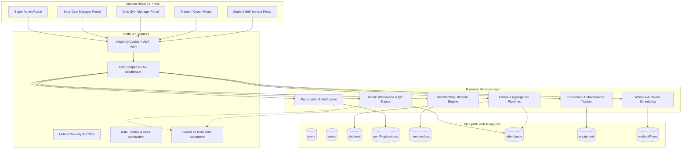

# VISHNUFIT — Smart Campus Gym Management System
### *Enterprise Multi-Facility Fitness Platform for Vishnu Institute of Technology, Bhimavaram*

[](https://github.com/YOUR_USERNAME/vishnufit-campus-gym-management)
[](https://www.mongodb.com/)
[](https://expressjs.com/)
[](https://vitejs.dev/)
[](https://tailwindcss.com/)
[](https://socket.io/)
[](https://opensource.org/licenses/MIT)

---

## 🏛️ Project Overview

**VISHNUFIT** is a full-stack, enterprise-grade campus gym management system engineered for **Vishnu Institute of Technology (VITB), Bhimavaram, Andhra Pradesh, India**. 

The platform addresses a fundamental collegiate campus requirement: managing two distinct physical fitness centers—**Vishnu Boys Gym** and **Vishnu Girls Gym**—under unified campus governance with shared database infrastructure, while enforcing strict backend logical isolation of operational records, check-ins, inventory, and staff permissions.

Designed according to Clean Architecture and Senior Full-Stack Engineering principles, **VISHNUFIT** eliminates manual ledger books, static unauthenticated spreadsheets, and credential sharing with an automated, real-time ecosystem featuring dynamic HMAC-signed QR cards, atomic concurrency check-in defenses, MongoDB aggregation analytics, and role-based access control.

---

## 🎯 Campus Problem Statement

Collegiate fitness centers at Vishnu Institute of Technology serve thousands of students daily across hostel and day-scholar demographics. Prior to VISHNUFIT, operations faced critical operational hurdles:
1. **Paper-Based Ledgers**: Slow manual queues at peak morning and evening hours causing congestion at entrance turnstiles.
2. **Dual-Facility Operational Segregation**: Boys Gym and Girls Gym operate under distinct physical staff and trainers. Storing data in separate ad-hoc systems led to fragmented campus reporting, while naive unified databases risked cross-facility data leakage.
3. **Card Sharing & Proxy Check-ins**: Static printed cards or shared QR screenshots enabled unauthorized entry and duplicate attendance entries.
4. **Uncoordinated Equipment Maintenance**: Equipment breakdowns were reported verbally, causing extended downtime on key weight stations and treadmills.
5. **Lack of Executive Analytics**: The Physical Education Directorate lacked real-time visibility into hourly peak loads, gender utilization ratios, and branch-wise engagement.

---

## ✨ Key System Features

### 1. Dual-Facility Multi-Tenant Architecture
- Centralized administration for Campus Super Admin (Physical Education Director).
- Facility-scoped portals for **Vishnu Boys Gym** (Student Activity Complex) and **Vishnu Girls Gym** (Women Amenities Complex).
- Enforced cross-facility boundary checks at the controller and middleware level; Managers cannot inspect or mutate records outside their assigned facility.

### 2. Smart Concurrency & Atomic Attendance
- **Manual Mode**: Instant roll-number lookup with active membership verification and duplicate active session prevention.
- **Dynamic QR Mode**: Generates cryptographically signed, 60-second time-sensitive tokens with nonce and HMAC verification.
- **Smart Tap Toggle**: Scanned once to check in; scanned again upon leaving to calculate workout duration automatically.
- **Atomic Concurrency Defense**: Indexed database constraints and atomic queries guarantee zero simultaneous active sessions per student across distributed scanning terminals.

### 3. Student Registration & Membership Lifecycle
- End-to-end approval pipeline (`PENDING` ➔ `APPROVED` ➔ `ACTIVE` ➔ `EXPIRED` / `SUSPENDED`).
- Issue digital membership cards with unique identifiers (e.g. `VITB-GYM-21PA1A0501-2025`).
- Configurable membership durations (1 Month Trial, 6 Months Semester Pass, 12 Months Annual Pass).

### 4. Interactive Aggregated Dashboards
- **Campus Super Admin Dashboard**: Real-time aggregated metrics powered by MongoDB aggregation pipelines (`$group`, `$match`, `$project`, `$facet`).
- **Interactive Recharts Visualizations**:
  - Monthly campus gym attendance trends.
  - Boys vs Girls Gym comparative utilization.
  - Student registrations categorized by engineering departments (CSE, ECE, IT, AI&DS, EEE, MECH, CIVIL, CSBS).
  - Peak hourly load distribution.
- **Facility Dashboards**: Live occupancy meters showing real-time capacity usage percentage and instant check-in feeds.

### 5. Equipment Asset & Maintenance Management
- Detailed equipment inventory (Cardio, Strength, Free Weights, Accessories).
- Condition meters (`EXCELLENT`, `GOOD`, `FAIR`, `POOR`) and availability counts.
- Maintenance ticket dispatching with cost logging, vendor assignments, and automated status transition to `UNDER_MAINTENANCE`.

### 6. Trainer Rosters & Workout Programming
- Trainer profiles with specializations, certifications, bio, and student load tracking.
- Structured workout plans with day-by-day routines, target muscles, sets, repetitions, and rest intervals.

### 7. Real-Time Engine (Socket.IO)
- Dedicated authenticated rooms (`super_admin`, `gym_{gymId}`, `user_{userId}`).
- Instant push notifications for new registrations, approvals, check-ins, check-outs, and equipment maintenance alerts.
- Automated TanStack Query cache invalidation keeping frontend views synchronized without page reloads.

---

## 🛠️ Mandatory Technology Stack

| Layer | Technologies Used |
| :--- | :--- |
| **Frontend** | React 18, Vite 6, Tailwind CSS, React Router v7, TanStack Query v5, React Hook Form, Zod, Recharts, Lucide React, Sonner, QRCode.react |
| **Backend** | Node.js (v24), Express.js (v4), Socket.IO (v4), bcryptjs, jsonwebtoken, cookie-parser, express-rate-limit, Helmet, CORS, Morgan |
| **Database** | MongoDB 7.0+ (Mongoose ODM v8) — *No SQL, No Prisma* |
| **Testing** | Vitest 2.1, Supertest 7.0 |
| **DevOps** | Docker, Docker Compose, Git, Postman Collection |

---

## 🏗️ System Architecture & Data Flow



---

## 📁 Repository Directory Structure

```text
vishnufit-campus-gym-management/
├── README.md                           # Master Project Documentation
├── LICENSE                             # MIT Open Source License
├── .gitignore                          # Git Exclusions
├── package.json                        # Monorepo Orchestration Scripts
├── docker-compose.yml                  # Multi-container Deployment Specification
│
├── client/                             # React + Vite Frontend Application
│   ├── package.json                    # Frontend Dependencies
│   ├── vite.config.js                  # Vite Build Configuration
│   ├── tailwind.config.js              # Theme Tokens & Palette Configuration
│   ├── postcss.config.js               # PostCSS Plugins
│   ├── index.html                      # HTML5 Entry Point with SEO Meta Tags
│   ├── .env.example                    # Client Environment Sample
│   └── src/
│       ├── main.jsx                    # React Mount Point
│       ├── App.jsx                     # Providers & Routing Entry
│       ├── context/                    # React Contexts (Auth, Theme, Socket)
│       ├── services/                   # Axios API & Socket.IO Clients
│       ├── components/
│       │   ├── Layout/                 # Navbar, Sidebar, AppLayout
│       │   └── Common/                 # StatCard, Badge, Modal, DataTable, etc.
│       ├── pages/                      # 19 Fully Integrated Application Pages
│       ├── routes/                     # Role-Based Route Definitions
│       └── styles/                     # Tailwind CSS & Glassmorphism Rules
│
├── server/                             # Node.js + Express Backend Service
│   ├── package.json                    # Backend Dependencies
│   ├── Dockerfile                      # Production Containerization Spec
│   ├── vitest.config.js                # Vitest Test Runner Config
│   ├── .env.example                    # Backend Environment Sample
│   ├── src/
│   │   ├── server.js                   # HTTP & Socket.IO Bootstrapper
│   │   ├── app.js                      # Express App Configuration & Route Mounts
│   │   ├── config/                     # Mongoose MongoDB Connection
│   │   ├── models/                     # 17 Mongoose Models & Schemas
│   │   ├── controllers/                # Business Logic Controllers
│   │   ├── middleware/                 # Auth, Gym Scope, Rate Limiter, Errors
│   │   ├── routes/                     # RESTful Route Modules
│   │   ├── validators/                 # Zod Request Validation Schemas
│   │   ├── sockets/                    # Socket.IO Event Rooms Handler
│   │   ├── seed/                       # Demonstration Database Seed Script
│   │   └── utils/                      # Cryptographic & QR Token Utilities
│   └── tests/                          # Automated Integration Test Suites
│
└── docs/                               # Comprehensive Technical Documentation
    ├── architecture.md                 # Deep Architectural Specification
    ├── mongodb-schema.md               # MongoDB Schema, Indexes & Mermaid ERD
    ├── api-documentation.md            # Detailed REST API Reference
    ├── installation-guide.md           # Step-by-Step Execution Guide
    └── VISHNUFIT.postman_collection.json # Ready-to-Import Postman API Collection
```

---

## 🔑 Pre-Seeded Demonstration Credentials

Run `npm run seed` to load fictional demonstration data into MongoDB. You can use these credentials directly or select them via the **1-Click Demo Selector** on the Login page:

| Role | Email | Password | Assigned Scope | Roll Number |
| :--- | :--- | :--- | :--- | :--- |
| **Super Admin** | `superadmin@vishnu.edu.in` | `SuperAdmin@123` | Campus-Wide (Both Gyms) | — |
| **Boys Gym Manager** | `manager.boys@vishnu.edu.in` | `ManagerBoys@123` | Vishnu Boys Gym | — |
| **Girls Gym Manager** | `manager.girls@vishnu.edu.in` | `ManagerGirls@123` | Vishnu Girls Gym | — |
| **Boys Gym Staff** | `staff.boys@vishnu.edu.in` | `Staff@123` | Vishnu Boys Gym | — |
| **Girls Gym Staff** | `staff.girls@vishnu.edu.in` | `Staff@123` | Vishnu Girls Gym | — |
| **Boys Coach** | `trainer.boys@vishnu.edu.in` | `Trainer@123` | Vishnu Boys Gym | — |
| **Girls Coach** | `trainer.girls@vishnu.edu.in` | `Trainer@123` | Vishnu Girls Gym | — |
| **Student (Male)** | `rahul.varma@vishnu.edu.in` | `Student@123` | Vishnu Boys Gym | `21PA1A0501` |
| **Student (Female)** | `ananya.reddy@vishnu.edu.in` | `Student@123` | Vishnu Girls Gym | `24PA1A0584` |

---

## ⚡ Quick Start & Installation

### Prerequisites
- **Node.js**: `v18.0.0` or higher (Tested on `v24.12.0`)
- **npm**: `v9.0.0` or higher
- **MongoDB**: Community Server running locally on port `27017` or a MongoDB Atlas connection string.

### 1. Clone & Install Dependencies
Open **Windows PowerShell** or terminal:
```powershell
# Clone the repository
git clone https://github.com/YOUR_USERNAME/vishnufit-campus-gym-management.git
cd vishnufit-campus-gym-management

# Install root, backend, and frontend dependencies in one step
npm run install:all
```

### 2. Configure Environment Variables
Copy the environment examples:
```powershell
# Server configuration
cp server/.env.example server/.env

# Client configuration
cp client/.env.example client/.env
```

Default settings in `server/.env`:
```env
PORT=5000
NODE_ENV=development
MONGODB_URI=mongodb://127.0.0.1:27017/vishnufit
JWT_SECRET=super_secure_jwt_secret_vishnufit_campus_gym_2025_vitb_bhimavaram
CLIENT_URL=http://localhost:5173
QR_SECRET=vishnufit_smart_qr_campus_token_secret_vitb
```

### 3. Seed MongoDB with Demonstration Records
Ensure MongoDB is running locally (`Get-Service MongoDB` on Windows or `net start MongoDB`):
```powershell
npm run seed
```

### 4. Start the Application
Run both backend and frontend concurrently:
```powershell
npm run dev
```

Application endpoints:
- **Frontend Portal**: [http://localhost:5173](http://localhost:5173)
- **Backend API**: [http://localhost:5000/api](http://localhost:5000/api)
- **System Health Check**: [http://localhost:5000/api/health](http://localhost:5000/api/health)

---

## 🧪 Automated Testing

All test suites verify real MongoDB interactions, role permissions, and atomic attendance concurrency:
```powershell
# Run backend tests
npm test
```

Test coverage includes:
- Authentication, invalid credential rejection, and HttpOnly JWT issuance.
- Role-based authorization & gym-scoped boundary defense (Boys Manager rejected on Girls Gym resources).
- Cross-facility check-in prevention.
- Atomic duplicate active check-in rejection (`409 Conflict`).
- Check-out duration computation in minutes.

---

## 🚀 Cloud Deployment Guide

### Frontend on Vercel
1. Link your GitHub repository in the Vercel Dashboard.
2. Set **Root Directory** to `client`.
3. Set **Build Command** to `npm run build` and **Output Directory** to `dist`.
4. Configure environment variable: `VITE_API_URL=https://your-backend.onrender.com/api`.

### Backend on Render
1. Create a **New Web Service** and connect your repository.
2. Set **Root Directory** to `server`.
3. Set **Build Command** to `npm install` and **Start Command** to `node src/server.js`.
4. Add environment variables:
   - `MONGODB_URI`: Your MongoDB Atlas cluster connection string.
   - `JWT_SECRET`: High-entropy production random string.
   - `CLIENT_URL`: Your deployed frontend Vercel domain.

---

## 📜 Disclaimer
This software is an independently developed academic full-stack project built for demonstration and evaluation at Vishnu Institute of Technology, Bhimavaram. It does not imply official campus administrative endorsement without explicit departmental authorization.

---

## 📄 License
This project is licensed under the [MIT License](LICENSE).
