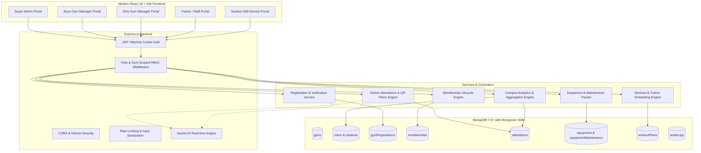
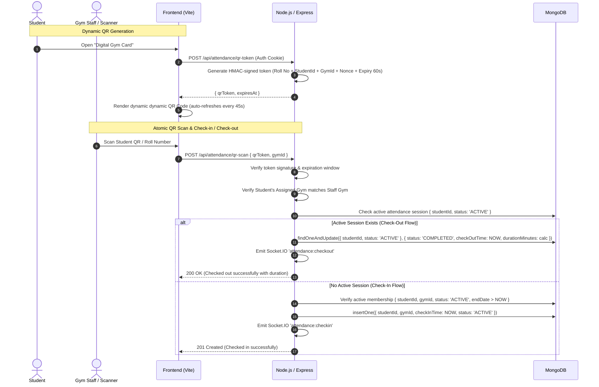

# VISHNUFIT — System Architecture Documentation
**Smart Campus Gym Management System | Vishnu Institute of Technology, Bhimavaram**

---

## 1. Executive Summary
**VISHNUFIT** is an enterprise-grade, centralized gym management platform tailored specifically for collegiate campuses. Built for **Vishnu Institute of Technology (VITB), Bhimavaram, Andhra Pradesh**, the platform solves the critical operational challenge of managing two distinct physical fitness centers:
- **Boys Gym Facility** (Capacity: 120 students/slot)
- **Girls Gym Facility** (Capacity: 100 students/slot)

While both facilities operate under unified campus governance, administrative authority, and shared database infrastructure, their daily operations—access verification, check-in flows, equipment logs, and trainer assignments—are strictly isolated at the database query and authorization middleware layers.

---

## 2. Multi-Tenant / Dual-Facility Architectural Model

### 2.1 Role-Based Access Control (RBAC) Matrix

| User Role | Campus Overview | Assigned Gym Operations | Cross-Gym Access | Student Self-Service | Equipment Maintenance |
| :--- | :---: | :---: | :---: | :---: | :---: |
| `SUPER_ADMIN` | Full (All Facilities) | Full | Full Override | Read-Only | Read / Write |
| `GYM_MANAGER` | Scope Locked to Facility | Full (Assigned Gym Only) | Strictly Forbidden | Approvals Only | Full for Assigned Gym |
| `GYM_STAFF` | Facility Operational View | Check-in / Out & Attendance | Strictly Forbidden | No | Report Issues |
| `TRAINER` | Assigned Trainees Only | View Schedules & Trainees | Strictly Forbidden | Workout Assignment | View Only |
| `STUDENT` | No Admin Access | Own Assigned Gym Only | Strictly Forbidden | Self Profile, QR Card, History | View Schedules Only |

---

## 3. Data Isolation Strategy
1. **Gym Document Reference**: All facility-scoped entities (`attendance`, `gymRegistrations`, `memberships`, `equipment`, `trainers`, `schedules`) store an explicit `gymId` foreign key referencing the `Gym` collection.
2. **Backend Enforcement**:
   - The authorization middleware `authorizeGymAccess` extracts the authenticated user's `role` and `assignedGym`.
   - If the user is `SUPER_ADMIN`, access to any gym resource or aggregated data is allowed.
   - If the user is `GYM_MANAGER` or `GYM_STAFF`, the middleware injects or verifies `gymId === req.user.assignedGym`. Any attempt to query or mutate an unauthorized gym ID returns HTTP `403 Forbidden`.
   - Never relies on client-side state, URL query strings, or unverified frontend tabs.

---

## 4. Smart Attendance & Atomic QR Verification Architecture

---

## 5. Real-Time Engine (Socket.IO Architecture)
Real-time events prevent stale concurrent records across staff scanning terminals and campus dashboards.

### Socket.IO Rooms
- `room:super_admin`: Receives live attendance count increments, new registration requests, and high-priority maintenance alerts campus-wide.
- `room:gym_{gymId}`: Receives check-in / check-out updates, pending approvals, and schedule notices specific to Boys Gym or Girls Gym.
- `room:user_{userId}`: Receives personal notifications (e.g., membership approved, trainer workout plan assigned).

### TanStack Query Invalidation
When the client receives a socket event (e.g., `attendance:updated`), TanStack Query automatically invalidates cache keys `['attendance', 'live']` and `['dashboard', gymId]`, triggering seamless, non-blocking UI refetches.

---

## 6. Security & Hardening Measures
- **HttpOnly Cookies**: JWT authentication tokens are signed with high-entropy secrets and transmitted via strict `HttpOnly`, `SameSite=Lax` cookies, neutralizing XSS credential theft.
- **CSRF & CORS Defense**: Server enforces explicit client origin (`http://localhost:5173` or production domain) with credential authorization.
- **Rate Limiting**: `express-rate-limit` prevents brute-force login attempts and attendance flooding.
- **MongoDB NoSQL Injection Protection**: Zod schema validation strips unpermitted operator payloads (`$gt`, `$ne`, etc.) before queries reach Mongoose.
