# VISHNUFIT — MongoDB Schema & Data Architecture
**Campus Gym Management Database Specification**

---

## 1. Entity-Relationship (ER) Diagram

```mermaid
erDiagram
    GYM ||--o{ GYM_STAFF_ASSIGNMENT : employs
    GYM ||--o{ STUDENT : assigns
    GYM ||--o{ GYM_REGISTRATION : receives
    GYM ||--o{ MEMBERSHIP : issues
    GYM ||--o{ ATTENDANCE : records
    GYM ||--o{ EQUIPMENT : owns
    GYM ||--o{ GYM_SCHEDULE : configures
    GYM ||--o{ ANNOUNCEMENT : posts

    USER ||--o| STUDENT : extends
    USER ||--o| TRAINER : extends
    USER ||--o{ GYM_STAFF_ASSIGNMENT : assigned_to
    USER ||--o{ AUDIT_LOG : initiates
    USER ||--o{ NOTIFICATION : receives

    STUDENT ||--o{ GYM_REGISTRATION : applies
    STUDENT ||--o{ MEMBERSHIP : holds
    STUDENT ||--o{ ATTENDANCE : logs
    STUDENT ||--o{ TRAINER_ASSIGNMENT : mentored_by
    STUDENT ||--o{ WORKOUT_PLAN : follows

    TRAINER ||--o{ TRAINER_ASSIGNMENT : coaches
    TRAINER ||--o{ WORKOUT_PLAN : designs

    EQUIPMENT ||--o{ EQUIPMENT_MAINTENANCE : undergoes
    MEMBERSHIP_TYPE ||--o{ MEMBERSHIP : classifies

    GYM {
        ObjectId _id PK
        string name "Vishnu Boys Gym / Vishnu Girls Gym"
        string code "BOYS_GYM / GIRLS_GYM (unique)"
        string location
        number capacity
        boolean isActive
        object contactInfo
        date createdAt
        date updatedAt
    }

    USER {
        ObjectId _id PK
        string name
        string email "unique"
        string passwordHash
        string role "SUPER_ADMIN|GYM_MANAGER|GYM_STAFF|TRAINER|STUDENT"
        ObjectId assignedGym FK "optional for Super Admin"
        string phone
        string avatar
        boolean isActive
        date lastLogin
        date createdAt
    }

    STUDENT {
        ObjectId _id PK
        ObjectId userId FK "unique"
        string rollNumber "unique, e.g. 21PA1A0501"
        string department "CSE|ECE|IT|MECH|CIVIL|AIDS|CSBS"
        number academicYear "1|2|3|4"
        string section "A|B|C"
        string contactNumber
        string studentType "Hosteller|Day Scholar"
        ObjectId assignedGym FK
        string membershipStatus "PENDING|ACTIVE|INACTIVE|SUSPENDED"
        string emergencyContact
        string profilePhoto
        date createdAt
    }

    GYM_REGISTRATION {
        ObjectId _id PK
        ObjectId studentId FK
        ObjectId gymId FK
        date applicationDate
        string status "PENDING|APPROVED|REJECTED|SUSPENDED|EXPIRED"
        ObjectId reviewedBy FK
        date reviewedAt
        string remarks
        string studentTypeSnapshot
        string preferredSlot
        date createdAt
    }

    MEMBERSHIP {
        ObjectId _id PK
        ObjectId studentId FK
        ObjectId gymId FK
        ObjectId membershipTypeId FK
        date startDate
        date endDate
        string status "ACTIVE|EXPIRED|SUSPENDED|CANCELLED"
        ObjectId approvedBy FK
        string qrCardId "unique"
        array renewalHistory
        date createdAt
    }

    MEMBERSHIP_TYPE {
        ObjectId _id PK
        string name "Monthly|Semester|Academic Year|Special Approved Access"
        string code "unique"
        number durationMonths
        number feeAmount "0 for default campus access"
        boolean isActive
    }

    ATTENDANCE {
        ObjectId _id PK
        ObjectId studentId FK
        ObjectId gymId FK
        date checkInTime
        date checkOutTime
        number durationMinutes
        string method "MANUAL|QR_SCAN"
        ObjectId recordedBy FK
        string status "ACTIVE|COMPLETED|AUTO_CLOSED"
        string notes
    }

    TRAINER {
        ObjectId _id PK
        ObjectId userId FK "unique"
        ObjectId gymId FK
        array specializations
        array certifications
        string bio
        number maxStudents
        boolean isAvailable
        number rating
    }

    WORKOUT_PLAN {
        ObjectId _id PK
        string title
        ObjectId studentId FK
        ObjectId trainerId FK
        ObjectId gymId FK
        string level "BEGINNER|INTERMEDIATE|ADVANCED"
        array weeklySchedule
        boolean isActive
        date createdAt
    }

    EQUIPMENT {
        ObjectId _id PK
        string name
        string code "unique"
        ObjectId gymId FK
        string category "CARDIO|STRENGTH|FREE_WEIGHTS|ACCESSORIES"
        number quantity
        number availableQuantity
        string condition "EXCELLENT|GOOD|FAIR|POOR"
        string status "AVAILABLE|IN_USE|UNDER_MAINTENANCE|OUT_OF_SERVICE"
        date lastMaintenanceDate
        date nextMaintenanceDate
        string notes
    }

    EQUIPMENT_MAINTENANCE {
        ObjectId _id PK
        ObjectId equipmentId FK
        ObjectId gymId FK
        ObjectId reportedBy FK
        string issueDescription
        string status "REPORTED|IN_PROGRESS|RESOLVED"
        number cost
        date serviceDate
        string notes
    }

    GYM_SCHEDULE {
        ObjectId _id PK
        ObjectId gymId FK
        number dayOfWeek "0-6"
        string openTime "06:00"
        string closeTime "21:00"
        boolean isClosed
        string specialNotes
    }

    ANNOUNCEMENT {
        ObjectId _id PK
        string title
        string content
        string targetAudience "ALL|BOYS_GYM|GIRLS_GYM|TRAINERS|STUDENTS"
        string priority "NORMAL|HIGH|URGENT"
        ObjectId gymId FK "optional"
        ObjectId createdBy FK
        date expiresAt
        boolean isActive
    }

    NOTIFICATION {
        ObjectId _id PK
        ObjectId recipientId FK
        ObjectId gymId FK "optional"
        string title
        string message
        string type "REGISTRATION|ATTENDANCE|MEMBERSHIP|WORKOUT|EQUIPMENT|ANNOUNCEMENT"
        boolean isRead
        object metadata
        date createdAt
    }

    AUDIT_LOG {
        ObjectId _id PK
        ObjectId userId FK
        string action
        string resource
        ObjectId resourceId
        ObjectId gymId FK "optional"
        string ipAddress
        object details
        date timestamp
    }

    CAMPUS_GYM_SETTINGS {
        ObjectId _id PK
        string campusName "Vishnu Institute of Technology, Bhimavaram"
        boolean boysGymOpen
        boolean girlsGymOpen
        boolean allowSelfRegistration
        boolean feeManagementEnabled
        number qrTokenExpirySeconds
        number defaultMembershipDurationDays
    }
```



---

## 2. Compound and Unique Indexes Specification

| Collection | Index Fields | Index Type | Purpose |
| :--- | :--- | :--- | :--- |
| `users` | `{ email: 1 }` | Unique | Prevent duplicate user login handles |
| `gyms` | `{ code: 1 }` | Unique | Immutable facility identifiers (`BOYS_GYM`, `GIRLS_GYM`) |
| `students` | `{ rollNumber: 1 }` | Unique | Prevent duplicate student enrollments |
| `students` | `{ userId: 1 }` | Unique | One-to-one Student profile per User |
| `students` | `{ assignedGym: 1, department: 1, academicYear: 1 }` | Compound | Fast student filtering by gym and class |
| `gymRegistrations` | `{ studentId: 1, gymId: 1, status: 1 }` | Compound | Fast lookup and active registration enforcement |
| `memberships` | `{ studentId: 1, gymId: 1, status: 1 }` | Compound | Membership validity queries |
| `memberships` | `{ qrCardId: 1 }` | Unique, Sparse | Fast lookup for digital card verification |
| `attendance` | `{ studentId: 1, status: 1 }` | Compound | **Atomic check-in prevention**: Ensure maximum 1 ACTIVE session |
| `attendance` | `{ gymId: 1, checkInTime: -1 }` | Compound | Fast live gym dashboard feeds and daily reports |
| `attendance` | `{ checkInTime: -1, status: 1 }` | Compound | Campus-wide real-time active student aggregations |
| `equipment` | `{ gymId: 1, code: 1 }` | Unique | Unique equipment inventory tags per gym |
| `equipment` | `{ gymId: 1, status: 1, category: 1 }` | Compound | Equipment condition and category breakdown |
| `auditLogs` | `{ gymId: 1, timestamp: -1 }` | Compound | Security and access audit filtering |
| `notifications` | `{ recipientId: 1, isRead: 1, createdAt: -1 }` | Compound | Instant user notification tray retrieval |

---

## 3. Atomic Attendance Prevention Rule
To guarantee that a student cannot check in twice simultaneously across concurrent requests or terminals:
1. An index `{ studentId: 1, status: 1 }` is maintained.
2. The check-in controller executes:
   ```javascript
   const existingSession = await Attendance.findOne({
     studentId,
     status: 'ACTIVE'
   });
   if (existingSession) {
     return res.status(409).json({ message: 'Student is already checked into a gym session.' });
   }
   ```
3. A unique partial index `{ studentId: 1, status: 1 }` where `{ status: 'ACTIVE' }` guarantees database-level uniqueness across distributed threads.
